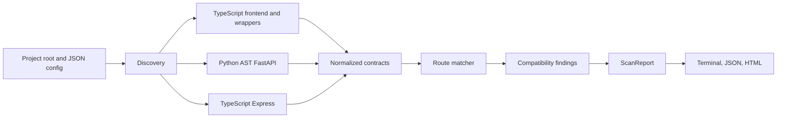

# Architecture

ContractWatch is a local static scanner. `scanProject()` coordinates discovery, parsing, matching, findings, and report data. It reads scanned source; it does not run the scanned application.

## Scan lifecycle

`src/index.ts` loads and validates `contractwatch.config.json`, discovers eligible files, runs analyzers, applies the optional frontend `baseUrl`, deduplicates diagnostics, matches contracts, calculates findings and summary, and returns a versioned `ScanReport`. Programmatic callers use `scanProject({ cwd, config })`. The CLI in `src/cli.ts` adds command parsing, bounded report writes, strict exit status, `diff`, `init`, and `doctor`.

## Discovery and analyzers

`src/core/discovery.ts` applies include/exclude globs, `.contractwatchignore`, size and binary filters, and symlink avoidance. `src/analyzers/frontend.ts` uses the TypeScript compiler AST to find supported fetch and Axios calls and their static URL, request, and response evidence. `src/analyzers/wrappers.ts` traces a bounded set of static fetch wrappers. Backend-looking JS/TS paths are withheld from frontend analysis.

`src/analyzers/express.ts` discovers route handlers and static router mounts across relative imports. `src/analyzers/fastapi.ts` coordinates Python files and calls `src/analyzers/python/parse_fastapi.py`. The Python helper runs in isolated mode and parses source with the standard `ast` module; it never imports the target project. Static router and model imports can be linked across discovered files. Dynamic mounts and unresolved imports produce diagnostics.

## Contracts and matching

Analyzers emit `ApiContract` records with source location, method, normalized path, resolution state, optional request/response schema, confidence, and evidence. `src/core/path.ts` normalizes paths. `src/core/matcher.ts` matches method and route segments, preferring exact paths; multiple candidates are ambiguous. `src/core/schema.ts` compares known fields and types. `src/core/findings.ts` checks missing routes, method mismatches, response fields/types/nullability/requiredness, required request fields and request types. Partial or dynamic evidence is handled conservatively.

Findings carry code, severity, confidence, expected/actual values, remediation, locations, and evidence. Severity can be configured for selected categories; confidence is capped by the contributing contracts and match. Health starts at 100, subtracting 20 per error and 7 per warning. It is a triage score.

## Reports and safety

`src/reporters/terminal.ts` renders human-readable output; JSON serializes `ScanReport`; `src/reporters/html.ts` creates a self-contained report with escaped source-derived text and local filters. CLI output paths must stay within the scanned project. Discovery skips symlinks, oversized and binary source; configuration is JSON only. Git diff uses argument-based subprocess invocation. See [SECURITY_REVIEW.md](SECURITY_REVIEW.md) for residual risks.
